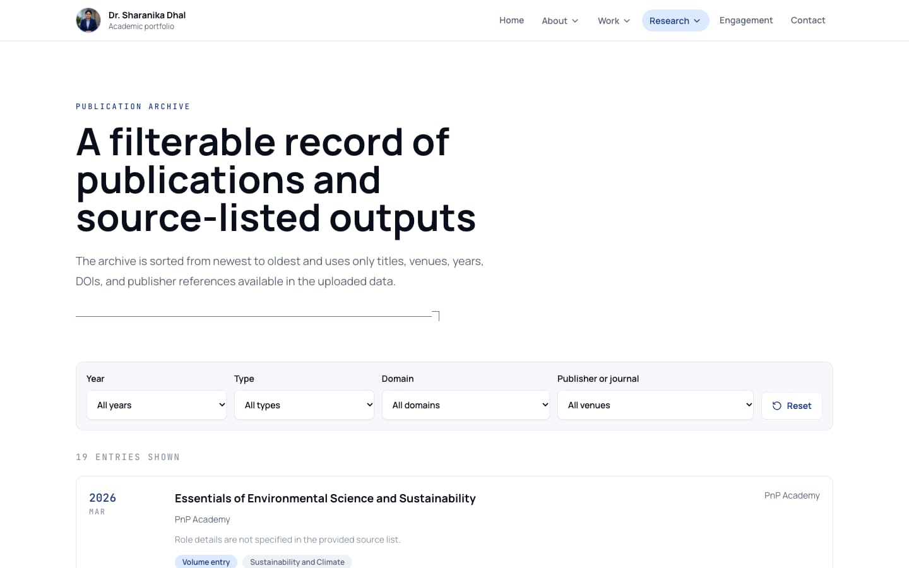
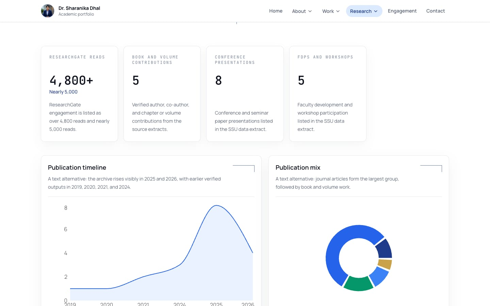

<div align="center">

# Dr. Sharanika Dhal — Academic Portfolio

Research, publications, books, and scholarly engagement of an HR academic at Sri Sri University, in one fast static site.

[](https://react.dev)
[](https://www.typescriptlang.org)
[](https://vite.dev)
[](https://tailwindcss.com)
[](https://motion.dev)
[](LICENSE)

</div>


## Overview

A single-page React application presenting the academic profile of **Dr. Sharanika Dhal**, Assistant Professor in HR at the Faculty of Management Studies, Sri Sri University. It brings her biography, experience, publications, books, conference work, science writing, awards and research impact together in one place.

All content lives in typed TypeScript data files, so updating the site means editing data rather than page markup. The publication charts (by year, by type, by theme) and the Science Writing chart are computed from those files, so they update automatically when entries are added.

**Live site:** https://sharanikadhal.co.in

## Features

| Section         | Route              | What it shows                                                                                                                                        |
| --------------- | ------------------ | ---------------------------------------------------------------------------------------------------------------------------------------------------- |
| Home            | `/`                | Hero with portrait and research focus, animated metric counters, publications-by-year and theme-distribution charts, and recent scholarly trajectory |
| About           | `/about`           | Academic biography, education, and milestones                                                                                                        |
| Experience      | `/experience`      | Chronological timeline of roles from clinical practice to HR and academia                                                                            |
| Impact          | `/impact`          | Scholarship dashboard: metric counters, publication timeline, publication mix, theme distribution and engagement-trend charts                        |
| Publications    | `/publications`    | Publication archive, newest first, filterable by year, type, domain and publisher or journal                                                         |
| Books           | `/books`           | Authored and edited-volume contributions with publisher links                                                                                        |
| Research Themes | `/research-themes` | Research themes with a theme-concentration chart                                                                                                     |
| Awards          | `/awards`          | Awards and recognitions in chronological order                                                                                                       |
| Conferences     | `/conferences`     | Paper presentations, FDPs and workshops, talks, and an engagement-timeline chart                                                                     |
| Science Writing | `/science-writing` | Science Horizon articles with a pieces-per-year chart                                                                                                |
| Gallery         | `/gallery`         | Source-referenced index of figures, maps, models and covers identified in her work                                                                   |
| Contact         | `/contact`         | Institutional identity, verified scholarly profile links, and an inquiry form                                                                        |

Every page uses a shared layout with a sticky header, dropdown navigation on desktop, a full-screen menu on mobile, and a footer with section and scholarly-profile links. Unknown paths show a "Page not found" screen, and `/dashboard` redirects to `/`.

Scroll-reveal animations use Framer Motion and are switched off when the visitor's operating system requests reduced motion. This does not apply to the animated number counters.

> **Contact form:** the form builds a `mailto:` draft addressed to `contact.email` in `src/data/contact.ts`. That field is currently empty because no verified email address has been provided, so the form shows a notice instead of sending anything.

<details>
<summary><strong>More screenshots</strong></summary>

<br />

**Publications archive with filters (desktop)**



**Research impact dashboard (desktop)**



**Home page (mobile, 390 px wide)**


</details>

## Tech stack

| Area         | Technology                                                                                           |
| ------------ | ---------------------------------------------------------------------------------------------------- |
| UI framework | [React 18](https://react.dev) with [React Router 6](https://reactrouter.com)                         |
| Language     | [TypeScript 5](https://www.typescriptlang.org) (strict mode)                                         |
| Build tool   | [Vite 5](https://vite.dev)                                                                           |
| Styling      | [Tailwind CSS 3](https://tailwindcss.com) with `tailwindcss-animate`                                 |
| Animation    | [Framer Motion](https://motion.dev) and [react-countup](https://github.com/glennreyes/react-countup) |
| Charts       | [Recharts](https://recharts.org)                                                                     |
| Icons        | [Lucide](https://lucide.dev)                                                                         |
| Fonts        | Manrope, Instrument Serif and JetBrains Mono from Google Fonts                                       |
| Tooling      | ESLint 9 (flat config, typescript-eslint, React Hooks rules) and Prettier 3                          |
| Hosting      | [Vercel](https://vercel.com)                                                                         |

## Project structure

```text
.
├── docs/images/              # README screenshots
├── public/
│   ├── favicon.svg
│   └── images/profile/       # Portrait used in the header, hero and mobile menu
├── src/
│   ├── components/portfolio/ # Layout, page intro, section heading, chart card, metric counter, reveal animation
│   ├── data/                 # All site content as typed data (edit these to update the site)
│   ├── lib/utils.ts          # cn() class-name helper
│   ├── pages/
│   │   ├── portfolio/        # One component per route
│   │   └── NotFound.tsx
│   ├── routes/router.tsx     # Route table
│   ├── App.tsx               # Router provider
│   ├── index.css             # Tailwind layers, CSS variables, font import
│   └── main.tsx              # Entry point
├── eslint.config.js
├── index.html
├── tailwind.config.ts
├── vercel.json               # Vercel config with SPA rewrite
└── vite.config.ts            # Vite config with the @/ → src/ alias
```

## Getting started

Requires Node.js 18.18 or newer and npm.

```bash
git clone https://github.com/Suraj-Dhal/sharanika-dhal-portfolio.git
cd sharanika-dhal-portfolio
npm install
npm run dev
```

The dev server runs at http://localhost:5173. It listens on all network interfaces (`--host 0.0.0.0`), so you can also open it from a phone on the same network.

## Scripts

| Command                | What it does                                                         |
| ---------------------- | -------------------------------------------------------------------- |
| `npm run dev`          | Start the Vite dev server with hot reload                            |
| `npm run build`        | Type-check, then build the production site to `dist/`                |
| `npm run preview`      | Serve the production build locally                                   |
| `npm run typecheck`    | Run the TypeScript compiler without emitting files                   |
| `npm run lint`         | Lint the project with ESLint                                         |
| `npm run format`       | Format all files with Prettier                                       |
| `npm run format:check` | Check formatting without writing changes                             |
| `npm run check`        | Run typecheck, lint, format check and build. Run this before pushing |

## Updating content

Site content lives in `src/data/`. Types for every entry are in `src/data/types.ts`, so the compiler catches missing or misspelled fields.

| File                | Content                                                                                                                               |
| ------------------- | ------------------------------------------------------------------------------------------------------------------------------------- |
| `profile.ts`        | Name, designation, institution, summary, verified links and headline metric counters                                                  |
| `education.ts`      | Degrees and institutions                                                                                                              |
| `experience.ts`     | Roles and career timeline                                                                                                             |
| `publications.ts`   | Publication archive (title, venue, year, type, domain, DOI)                                                                           |
| `books.ts`          | Books and edited-volume contributions                                                                                                 |
| `researchThemes.ts` | Research themes                                                                                                                       |
| `conferences.ts`    | Conference presentations and talks                                                                                                    |
| `workshops.ts`      | FDPs and workshops                                                                                                                    |
| `scienceWriting.ts` | Science Horizon articles                                                                                                              |
| `awards.ts`         | Awards and recognitions                                                                                                               |
| `gallery.ts`        | Gallery index entries                                                                                                                 |
| `contact.ts`        | Contact details (set `email` to enable the contact form)                                                                              |
| `impact.ts`         | Chart series: publication charts are computed from `publications.ts` and `researchThemes.ts`; the engagement trend is entered by hand |

Run `npm run check` after editing to catch type errors before deploying. To change the portrait, replace `public/images/profile/sharanika-dhal.jpg` and keep the same file name.

## Deployment

The site is deployed on [Vercel](https://vercel.com). `vercel.json` selects the Vite framework preset (build command `npm run build`, output directory `dist`) and adds a rewrite of every path to `/`, so deep links such as `/publications` load the app instead of returning a 404. Static files in `dist/` are still served directly.

Any static host works as long as it serves `index.html` for unknown paths.

## License

The source code is released under the [MIT License](LICENSE).

The biography, photographs, publication records and other personal content belong to Dr. Sharanika Dhal and are **not** covered by the MIT License. Do not reuse them without permission.

## Maintainer

Built and maintained by [Suraj Dhal](https://surajdhal.com).
